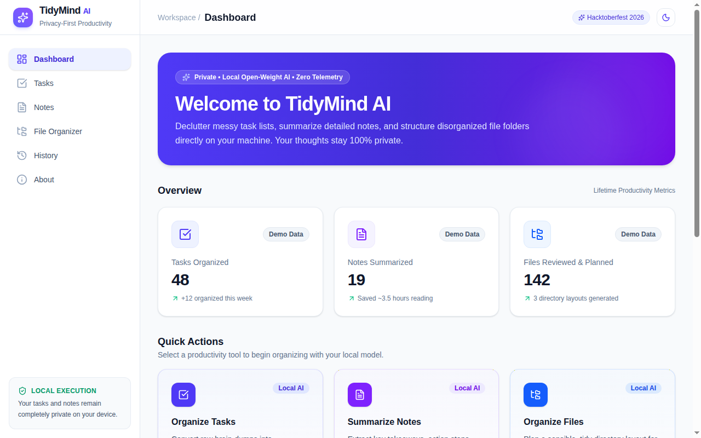
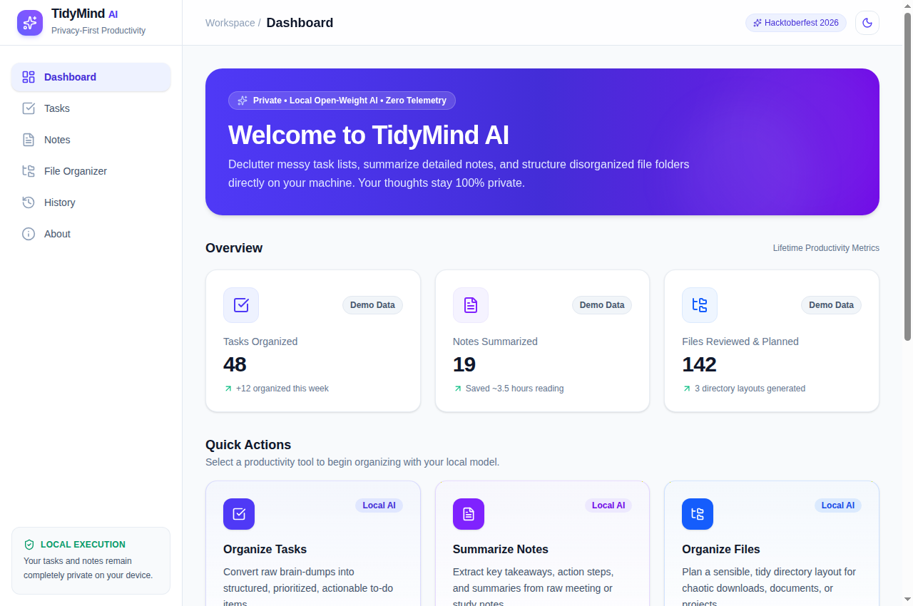

# TidyMind AI

> **Privacy-First Local AI Productivity Assistant**  
> Built for the **Hacktoberfest 2026 Week 3: "Slow and Steady"** challenge.

TidyMind AI is a local-first productivity tool that helps you organize messy task dumps, distill unstructured notes into actionable insights, and safely plan filesystem cleanup—all powered by open-weight AI models running locally on your own machine.

---

## Table of Contents

- [Problem Statement & Target Users](#problem-statement--target-users)
- [Hacktoberfest Week 3: "Slow and Steady"](#hacktoberfest-week-3-slow-and-steady)
- [Features & Workflows](#features--workflows)
- [How Open-Weight Local AI is Used](#how-open-weight-local-ai-is-used)
- [Technology Stack & Architecture](#technology-stack--architecture)
- [Prerequisites](#prerequisites)
- [Ollama Setup & Model Configuration](#ollama-setup--model-configuration)
- [Environment Variables](#environment-variables)
- [Installation & Running the Application](#installation--running-the-application)
- [Demo Mode](#demo-mode)
- [API Health Checks](#api-health-checks)
- [Running Automated Tests](#running-automated-tests)
- [Privacy & Filesystem Safety Invariants](#privacy--filesystem-safety-invariants)
- [Screenshots & Visuals](#screenshots--visuals)
- [Known Limitations & Future Scope](#known-limitations--future-scope)
- [Contributing](#contributing)
- [License](#license)

---

## Problem Statement & Target Users

### The Problem
Modern knowledge workers, developers, and students constantly capture unstructured notes, rapid-fire brainstorms, and scattered files across local directories. While cloud-hosted AI tools offer summarization and task extraction, they require sending private personal data, confidential meeting transcripts, and project files to third-party cloud servers.

### Target Users
- **Developers & Engineers**: Who need to sanitize daily brainstorms and organize messy project directories without exposing proprietary code or notes to external cloud APIs.
- **Privacy-Conscious Professionals**: Who handle sensitive meeting notes and personal task lists and want complete data sovereignty.
- **Students & Researchers**: Who want a distraction-free, calm interface to structure study plans and lecture notes locally.

---

## Hacktoberfest Week 3: "Slow and Steady"

TidyMind AI is built specifically for the **"Slow and Steady"** theme:
1. **Calm, Intentional Productivity**: Rather than overwhelming users with automated clutter, TidyMind emphasizes deliberate, mindful organization. It features calm aesthetics, subtle blue and violet accents, high contrast readability, and purposeful workflows.
2. **Deterministic Control Over Blind Automation**: The file organizer never executes unexpected mass moves or silent deletions. It presents a clear review plan with reasons for each proposed change and requires explicit checkbox confirmation before applying any action.
3. **Safe Reversibility & Auditability**: Every operation is logged locally in an SQLite audit trail, with built-in safe rollback/undo capabilities for file reorganizations.
4. **Resilient Offline Architecture**: By combining local open-weight inference with a deterministic rule-based demo fallback, TidyMind remains fully functional and useful even completely offline.

---

## Features & Workflows

### 1. Task Organizer
- **Unstructured Ingestion**: Paste messy, freeform to-do dumps and bullet lists.
- **Structured Extraction**: Automatically categorizes tasks (e.g., *Development*, *Design*, *Administrative*, *Documentation*), assigns sensible priority ratings (*High*, *Medium*, *Low*), estimates realistic durations, and suggests an achievable execution order.
- **Interactive Management**: Mark tasks complete with visual strikethrough, inline-edit titles, and delete individual items.
- **One-Click Clear**: Clear the workspace with an explicit safety confirmation dialog.

### 2. Notes Summarizer
- **Tri-Fold Distillation**: Extracts a crisp executive summary, bulleted key points, and actionable next steps.
- **Input Guardrails**: Real-time character counter with validation to prevent submitting empty notes or exceeding context boundaries (30,000 characters).
- **One-Click Clipboard**: Instant button to copy formatted summaries to your clipboard.
- **Zero Note Retention**: Raw note text is processed in memory and never written to database tables or server log files.

### 3. Safe File Organizer
- **Boundary-Restricted Scanning**: Only scans directories explicitly approved in server configuration (`APPROVED_DIRECTORIES`). Arbitrary directories and path traversals (`../`) are strictly blocked.
- **Inspection Table**: Displays current filename, file extension, byte size, proposed destination subfolder, and reason for change.
- **AI & Rule-Based Suggestions**: Proposes cleaner, standardized filenames and organized subdirectories based on file extensions.
- **Dry-Run Preview & Explicit Confirmation**: Users must explicitly review and select specific files before any filesystem modification occurs.
- **Anti-Overwrite Protection**: Halts if a destination path already exists—existing files are never overwritten or replaced.
- **Zero Deletion**: The system contains no file deletion functions.

### 4. Activity History & Safe Undo
- **Persistent SQLite Audit Trail**: Records operation timestamps, operation types, status, and summary descriptions in `tidymind_history.db`.
- **Filtering**: Filter records by operation type (*Tasks*, *Notes*, *Files*) or status (*Success*, *Failed*, *Info*).
- **One-Click Safe Undo**: Safely rolls back file renames/moves after verifying the original location is free and the file has not been modified.
- **Safe History Clear**: Purges audit logs upon user confirmation without touching or modifying any user files on disk.

### 5. Polished Design & Navigation
- **Theme Persistence**: Light and dark themes with persistent preference saved to `localStorage`.
- **Responsive Layout**: Sidebar navigation for desktop and responsive drawer navigation for mobile devices.
- **Ollama Status Indicator**: Real-time status badge in the header displaying local AI model connectivity.

---

## How Open-Weight Local AI is Used

TidyMind AI integrates with **[Ollama](https://ollama.com/)** to execute open-weight large language models locally:

- **Model Compatibility**: Defaults to Google's open-weight **`gemma:2b`** (or `gemma2:2b`, `llama3.2:3b`), offering fast, lightweight inference on standard laptops without requiring a dedicated discrete GPU.
- **Strict Structured Outputs**: Prompts instruct the local model to return strict, machine-readable JSON payloads, which are validated on the backend using Pydantic schemas.
- **Fault-Tolerant Parsing**: If the local model wraps output in markdown code fences or includes trailing text, the backend parses the JSON payload reliably or gracefully fails with clear feedback.
- **Zero Data Leakage**: Requests travel exclusively over local HTTP (`http://127.0.0.1:11434`). No prompts, notes, or tasks are ever transmitted over the public internet.

---

## Technology Stack & Architecture

```text
+--------------------------------------------------------------+
|                     Browser (React + Vite)                   |
|  - Tailwind CSS Styling (Dark/Light Modes)                   |
|  - Task Organizer | Notes Summarizer | File Organizer         |
|  - Activity History & Safe Undo | About / Help Guide         |
+------------------------------+-------------------------------+
                               |  Local REST API calls
                               v
+--------------------------------------------------------------+
|                     FastAPI Backend                          |
|  - Request & Response Validation (Pydantic v2)               |
|  - Filesystem Safety & Path Traversal Guards                 |
|  - SQLite Persistent Audit History (tidymind_history.db)     |
+---------------+------------------------------+---------------+
                |                              |
                v                              v
+-------------------------------+   +--------------------------+
|  Local Ollama Engine          |   |  Local Filesystem        |
|  - http://127.0.0.1:11434     |   |  - Approved Roots Only   |
|  - gemma:2b / llama3.2        |   |  - Strict Dry-Run & Move |
|  - 100% On-Device Inference   |   |  - Zero Deletion Policy  |
+-------------------------------+   +--------------------------+
```

### Components
- **Frontend**: React 18, Vite, Tailwind CSS, Lucide React icons.
- **Backend**: Python 3.10+, FastAPI, Uvicorn, Pydantic v2, SQLite3.
- **Local AI Engine**: Ollama running locally.
- **Testing**: Pytest, FastAPI TestClient (`httpx`).

---

## Prerequisites

Before setting up TidyMind AI, ensure your system has:
- **Python**: Version 3.10 or higher (`python3 --version`)
- **Node.js**: Version 18 or higher (`node --version`) and **npm** (`npm --version`)
- **Ollama** *(Optional for Demo Mode, recommended for full local AI)*: Installed from [ollama.com](https://ollama.com/)

---

## Ollama Setup & Model Configuration

1. **Install Ollama**:
   - **Linux / macOS**:
     ```bash
     curl -fsSL https://ollama.com/install.sh | sh
     ```
   - **Windows**: Download the installer from [ollama.com/download](https://ollama.com/download).

2. **Pull the Recommended Open-Weight Model**:
   ```bash
   ollama pull gemma:2b
   ```
   *(Alternatively, you can pull `llama3.2:latest` or `gemma2:2b`).*

3. **Verify the Ollama Service**:
   Ensure Ollama is running and accessible:
   ```bash
   ollama serve
   ```
   Test in another terminal:
   ```bash
   ollama list
   ```

---

## Environment Variables

The backend configuration is managed via environment variables. An example template is provided in [`backend/.env.example`](backend/.env.example).

To customize, copy the example to `.env`:
```bash
cd tidymind-ai/backend
cp .env.example .env
```

### Available Configuration Settings

| Variable | Default Value | Description |
| :--- | :--- | :--- |
| `OLLAMA_BASE_URL` | `http://127.0.0.1:11434` | The local endpoint where the Ollama service is listening. |
| `OLLAMA_MODEL` | `gemma:2b` | The name of the installed model to use for inferences. |
| `OLLAMA_TIMEOUT_SECONDS` | `60` | Maximum wait time in seconds for local model inference. |
| `APPROVED_DIRECTORIES` | *Project workspaces* | Comma-separated absolute paths permitted for file scanning. |

---

## Installation & Running the Application

### 1. Backend Setup

```bash
# Navigate to the backend directory
cd tidymind-ai/backend

# Create a virtual environment using Python 3
python3 -m venv venv

# Activate the virtual environment
# On Linux/macOS:
source venv/bin/activate
# On Windows:
# venv\Scripts\activate

# Install required dependencies
pip install -r requirements.txt

# Start the FastAPI server with hot-reload
uvicorn main:app --host 127.0.0.1 --port 8000 --reload
```
- The backend API will be available at: `http://127.0.0.1:8000`
- Interactive Swagger documentation: `http://127.0.0.1:8000/docs`

### 2. Frontend Setup

In a separate terminal:

```bash
# Navigate to the frontend directory
cd tidymind-ai/frontend

# Install dependencies
npm install

# Start the Vite development server
npm run dev
```
- Open your browser to: `http://localhost:5173`

---

## Demo Mode

TidyMind AI includes a **built-in Demo Mode** that allows you to test the complete application without installing or running Ollama:

- **Explicit Labeling**: Every response generated via Demo Mode is clearly tagged with a yellow `Demo Mode` badge so real AI inference is never mimicked or misrepresented.
- **Deterministic Parsers**: Uses rule-based local heuristics to structure tasks, extract bulleted points, and generate file categories.
- **Automatic Fallback**: If Ollama is offline or uninstalled, the application provides an option to run operations in Demo Mode seamlessly.

---

## API Health Checks

The backend provides a comprehensive health endpoint reporting system readiness, Ollama connectivity, model availability, and approved filesystem roots.

### Check Status via cURL:
```bash
curl -s http://127.0.0.1:8000/api/health
```

### Example Healthy Response:
```json
{
  "status": "healthy",
  "ollama_connected": true,
  "ollama_base_url": "http://127.0.0.1:11434",
  "selected_model": "gemma:2b",
  "model_available": true,
  "approved_directories": [
    "/home/user/tidymind-ai/sample_organizer_workspace",
    "/home/user/tidymind-ai/docs"
  ]
}
```

If Ollama is stopped, `"ollama_connected": false` and `"model_available": false` will be returned, while the backend `"status"` remains `"healthy"`.

---

## Running Automated Tests

TidyMind AI includes a comprehensive test suite covering API endpoints, edge cases, model fallbacks, path traversal security, and safe undo capabilities.

Run the test suite with `pytest`:

```bash
cd tidymind-ai/backend
source venv/bin/activate
pytest -v
```

### Verified Test Suite Coverage:
- `test_root_endpoint`: Verifies API root status message.
- `test_health_endpoint`: Verifies Ollama connectivity and directory reports.
- `test_demo_service_logic`: Tests deterministic rule-based fallback logic.
- `test_organize_endpoint_empty_input`: Validates 422 error on empty task input.
- `test_organize_endpoint_explicit_demo`: Validates task organization via demo mode.
- `test_organize_endpoint_live_inference_if_available`: Tests live local AI execution.
- `test_summarize_notes_empty_input`: Validates rejection of empty note text.
- `test_summarize_notes_excessive_length`: Validates 30,000 character limit enforcement.
- `test_summarize_notes_demo_mode_valid_output`: Tests tri-fold note extraction.
- `test_summarize_notes_unavailable_ollama`: Verifies graceful failure when Ollama is offline.
- `test_summarize_notes_malformed_ai_output`: Tests recovery against invalid model outputs.
- `test_summarize_notes_live_inference_if_available`: Validates live note summarization.
- `test_file_organizer_scan_unapproved_directory`: Enforces 403 on unapproved directories.
- `test_file_organizer_path_traversal_rejection`: Prevents `../` directory escapes.
- `test_file_organizer_dry_run_and_safe_apply`: Verifies review table and approved moves.
- `test_file_organizer_prevent_destination_overwrite`: Blocks collisions and overwrites.
- `test_history_creation_and_filters`: Validates SQLite audit log recording and filtering.
- `test_history_clear_safety`: Confirms clearing audit logs leaves disk files intact.
- `test_file_operations_safe_undo`: Tests safe file move rollback and verification.

---

## Privacy & Filesystem Safety Invariants

TidyMind AI enforces strict privacy and filesystem boundaries:

1. **100% Local Processing**: No user data, task descriptions, or note contents are ever transmitted to third-party cloud services.
2. **Zero Content Persistence**: Note bodies and task drafts are processed in-memory and discarded. Only high-level operation metadata (e.g., `"Summarized 240 words of meeting notes"`) is recorded in the SQLite history.
3. **Strict Whitelist Boundary**: File scanning and movement are restricted solely to paths listed in `APPROVED_DIRECTORIES`. Path traversal attempts (`../../`) trigger an immediate `403 Forbidden`.
4. **No Destructive Operations**: TidyMind AI contains **no deletion code**. Files are only organized into subfolders.
5. **Anti-Overwrite Protection**: If a target destination filename already exists, the move is rejected to prevent data loss.
6. **No Symlink Traversal**: Symbolic links are not followed to avoid unintended directory escapes.
7. **Explicit Dry-Run Requirement**: Files are never moved automatically during a scan. Moves are executed only after explicit user selection and confirmation.

---

## Screenshots & Visuals

*(Screenshots can be placed in `docs/screenshots/`)*

| Screen | Preview |
| :--- | :--- |
| **Dashboard** | <br>*(Placeholder: Calm overview with quick stats and local AI status)* |
| **Task Organizer** | <br>*(Placeholder: Unstructured input transformed into categorized, prioritized tasks)* |
| **Notes Summarizer** | <br>*(Placeholder: Tri-fold breakdown into Summary, Key Points, and Action Items)* |
| **File Organizer** | <br>*(Placeholder: Safe directory scan with review table and approval modal)* |
| **Activity History** | <br>*(Placeholder: Filterable audit log with one-click safe undo)* |

---

## Known Limitations & Future Scope

### Known Limitations
- **Browser Sandboxing**: Due to web browser security policies, web applications cannot directly read arbitrary local filesystem paths via native dialogs without server-side path configuration. TidyMind resolves this safely using approved root presets.
- **Model Context Window**: Small local models (`gemma:2b`) have limited context lengths and can struggle with note documents exceeding 30,000 characters.
- **Non-Recursive Scanning**: To prioritize safety and avoid unintended recursive modifications, the File Organizer operates only on top-level files in the selected folder.

### Future Scope
- **Batch Document Ingestion**: Support dragging `.txt` or `.md` files directly into the Notes Summarizer.
- **Custom Categorization Rules**: Allow users to define custom file-extension mapping rules via the settings UI.
- **Additional Local Backends**: Add direct compatibility with llama.cpp or LocalAI alongside Ollama.

---

## Contributing

Contributions are welcome! Please follow these guidelines:

1. **Keep it Local**: Never introduce dependencies or integrations that transmit user text or files to external cloud APIs.
2. **Preserve Safety Invariants**: Ensure all filesystem operations maintain anti-overwrite checks, approved directory whitelists, and zero-deletion policies.
3. **Write Tests**: Add corresponding `pytest` tests for any new backend endpoints or safety validations.
4. **Format & Lint**: Ensure clean code formatting and verify that both `npm run build` and `pytest` pass before opening a Pull Request.

---

## License

This project is open-source. Please see the [LICENSE](LICENSE) file for terms and conditions.
